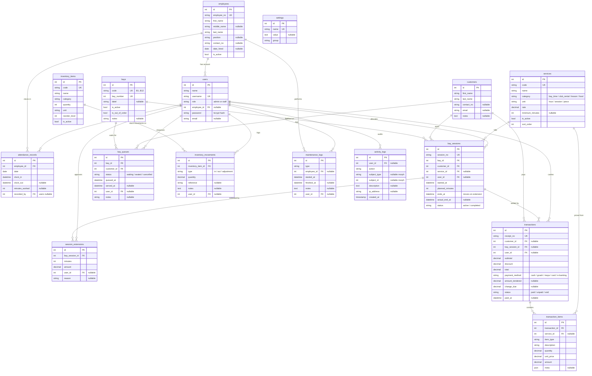

# DEGMS — Entity-Relationship Diagram

Updated ERD for **A Facility-based Management Information System for Davao EagleMasters Driving Range** (replaces Figure 5, Chapter 3).
Every entity and attribute below is derived from the actual migrations in `database/migrations/` — nothing is aspirational.

## Mermaid ERD

## Relationship notes

| Relationship | FK / delete rule | Paper concept it replaces |
|---|---|---|
| employees → users | `users.employee_id`, nullable, null on delete | Staff account with RBAC role (`admin` / `staff`) |
| employees → attendance_records | cascade on delete; unique `(employee_id, clock_in)` | Paper **Daily Time Record sheet** |
| bays / customers / services / users → bay_sessions | restrict / restrict / null / null | Front-desk **manual logbook** (time-in/out) |
| bay_sessions → session_extensions | cascade on delete | Add-time entries (+15 / +20 / +1h30m) |
| bay_sessions → transactions | nullable, null on delete | Receipt book |
| transactions → transaction_items | cascade on delete | Line items on the printed official receipt |
| bays / customers → bay_queues | restrict on delete | "Pending spot" waiting list |
| users → activity_logs | nullable, null on delete | **Audit trail** (new — replaces nothing manual) |

## Scope notes

- **Framework tables excluded from the diagram** (not domain data): `sessions`, `password_reset_tokens`, `cache`, `jobs`.
- `inventory_items`, `inventory_movements` and `maintenance_logs` are **schema-ready but have no delivered UI module** — consistent with the paper's Scope and Limitations.
- `transactions.payment_method` records `gcash`, `maya`, `card`, `e-banking` as **record-only placeholders — no payment gateway** (school demo, as stated in the paper).
- Business rules encoded in the schema: minimum session 90 min (`services.minimum_minutes` / `settings.minimum_session_minutes`), 12 bays (`bays` B1–B12), operating hours 06:00–22:00 (`settings`), "soon to expire" threshold 10 min (`settings`), ₱300/hr bay rate (`services.rate`).
